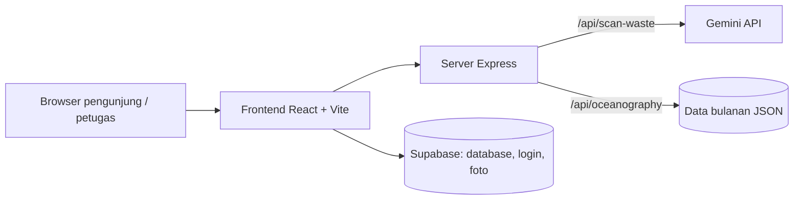

# SEABRIS — Smart Marine Debris Management System

Sistem pengumpul dan pemantau sampah pesisir berbasis IoT untuk mitigasi pencemaran plastik di Teluk Jakarta, dengan studi kasus **Muara Angke**.

**Website:** https://seabrisweb-production.up.railway.app/

## Latar Belakang

Sampah dari sungai-sungai Jakarta terbawa arus ke Teluk Jakarta, dan Muara Angke menjadi salah satu titik penumpukannya. Membersihkan sampah setelah menyebar ke laut jauh lebih sulit daripada menahannya di muara. Pemantauan manual juga sering terlambat, sehingga tempat penampung dapat meluap saat hujan deras atau banjir kiriman.

SEABRIS menjawab masalah itu dengan lima langkah:

1. **Floating barrier** menahan dan mengarahkan sampah terapung.
2. **Keranjang penampung** baja galvanis menampung sampah yang tertahan.
3. **Sensor ultrasonik** (JSN-SR04T) mengukur ketinggian tumpukan sampah.
4. **ESP32** mengirim data keterisian ke cloud, dengan notifikasi otomatis pada 80% dan 90%.
5. **Tim lapangan** mengevakuasi sampah sebelum keranjang meluap.

> Status: website ini adalah **prototipe**. Nilai sensor pada website berupa simulasi, belum tersambung ke perangkat fisik.

## Fitur

**Halaman publik (tanpa login)**

| Menu | Fungsi |
|---|---|
| Beranda | Latar belakang masalah, foto kondisi lapangan, edukasi sampah Muara Angke |
| AI Waste Scanner | Deteksi sampah langsung lewat kamera dan analisis foto dengan AI |
| Oseanografi | Grafik muka air laut, arus, dan tinggi gelombang per bulan |
| Laporkan Sampah | Form laporan masyarakat dengan foto dan lokasi GPS, menghasilkan nomor tiket |
| Cara Kerja | Penjelasan alur sistem |

**Portal petugas dan admin (perlu login)**

Pemantauan perangkat dan peta, model digital twin 3D, riwayat dan analitik scan, pengelolaan laporan masyarakat, notifikasi, serta pengelola konten halaman utama.

## Algoritma dan AI

| Algoritma | Lokasi | Cara kerja singkat |
|---|---|---|
| **CNN: COCO-SSD** (SSD + MobileNetV2) | `src/components/scanner/RealTimeCamera.tsx` | Frame kamera dipindai tiap 250 ms di browser (TensorFlow.js). Hanya deteksi dengan skor ≥ 0,55 yang ditampilkan |
| **Gemini Vision** (Transformer multimodal) | `server.ts` (`POST /api/scan-waste`) | Foto dianalisis menjadi JSON terstruktur: kategori, material, risiko, rekomendasi. Ada 3 model cadangan |
| Normalisasi linear kapasitas | `src/data/seabrisSystem.ts`, `src/services/iotService.ts` | Isi (%) = (25 − jarak sensor) ÷ 25 × 100, dibatasi 0–100 |
| Klasifikasi ambang batas | `src/services/iotService.ts` | ≥ 80% *warning*, ≥ 90% kritis, memicu log dan notifikasi |
| Rate limiter (fixed-window) | `server.ts` | 15 permintaan per IP per jam, 300 per hari global |
| Statistik dan agregasi | `src/services/iotService.ts`, dashboard analitik | Distribusi kategori, rasio plastik, tren 7 hari |

Kedua model AI dipakai apa adanya (*pretrained*), tidak dilatih sendiri. Hasil AI hanya identifikasi awal dan selalu ditandai **perlu verifikasi petugas**.

## Teknologi

| Bagian | Teknologi |
|---|---|
| Bahasa | TypeScript (TSX untuk tampilan), HTML, CSS, JSON, SQL |
| Frontend | React 19, Vite 8, Tailwind CSS 4, Recharts, Three.js, Leaflet, Motion |
| Backend | Node.js, Express |
| AI | TensorFlow.js + COCO-SSD, Google Gemini API |
| Basis data dan login | Supabase (PostgreSQL, Auth, Storage, Realtime) |
| Hosting | Railway |



## Struktur Proyek

```
├── server.ts                  # Server Express: API scan, API oseanografi, serve hasil build
├── index.html
├── public/                    # Aset statis dan manifest
└── src/
    ├── App.tsx                # Pengatur halaman dan peran pengguna
    ├── components/
    │   ├── auth/              # Popup login
    │   ├── common/            # Navbar, footer, gauge kapasitas
    │   ├── landing/           # Halaman utama, slider foto, edukasi
    │   ├── public/            # Form laporan, simulasi sensor, alur sistem
    │   ├── scanner/           # AI Waste Scanner dan kamera real-time
    │   └── dashboard/         # Portal petugas dan dashboard oseanografi
    ├── services/              # iotService, authService, landingCmsService, oceanographyService
    ├── data/                  # Spesifikasi sistem, data awal, data oseanografi bulanan
    ├── lib/supabase.ts        # Klien Supabase
    └── types/                 # Tipe data TypeScript
```

## Menjalankan di Komputer

Prasyarat: **Node.js 22 atau lebih baru**.

```bash
git clone https://github.com/atikadalila1234-hub/seabrisweb.git
cd seabrisweb
npm install
cp .env.example .env      # Windows: copy .env.example .env
npm run dev
```

Buka http://localhost:3000. Isi file `.env` sebelum menjalankan:

| Variabel | Wajib | Fungsi |
|---|---|---|
| `GEMINI_API_KEY` | Ya (untuk analisis foto) | Kunci Gemini API, dipakai di server |
| `VITE_SUPABASE_URL` | Ya | Alamat proyek Supabase, ditanam saat build |
| `VITE_SUPABASE_ANON_KEY` | Ya | Kunci publik (anon) Supabase, ditanam saat build |
| `SCAN_LIMIT_PER_IP_HOUR` | Tidak | Batas scan per IP per jam (bawaan 15) |
| `SCAN_GLOBAL_DAILY_CAP` | Tidak | Batas scan global per hari (bawaan 300) |
| `PORT` | Tidak | Port server (bawaan 3000) |

> Jangan pernah memasukkan file `.env` ke Git. File ini sudah terdaftar di `.gitignore`.

Menjalankan versi produksi:

```bash
npm run build
NODE_ENV=production npm start
```

## Deploy ke Railway

```bash
npm install -g @railway/cli
railway login
railway link
railway up
```

Isi variabel di tab **Variables** layanan Railway (termasuk `NODE_ENV=production`) **sebelum** `railway up`, karena variabel `VITE_...` ditanam saat build. Setelah itu jalankan `railway domain` untuk membuat alamat publik.

## Basis Data

Supabase memakai tabel: `devices`, `sensor_logs`, `notifications`, `waste_scans`, `waste_reports`, `landing_cms`, `system_settings`, dan `profiles` (peran: `admin`, `operator`). Skrip SQL pembuatan tabel **[belum disertakan di repo — tambahkan jika diperlukan]**.

## Sumber Data

| Data | Keterangan |
|---|---|
| Oseanografi (muka air laut, arus, gelombang) | Data bulanan Jan 2025 – Nov 2026 pada `src/data/pasut_muara_angke.json`. Berkas mencantumkan sumber: Badan Informasi Geospasial (BIG), BMKG Stasiun Meteorologi Maritim Tanjung Priok, dan Copernicus Marine Service (CMEMS). Data ilustratif bulanan Jan 2025 – Nov 2026 pada src/data/pasut_muara_angke.json, disusun dengan bantuan AI berdasarkan pola musiman perairan Teluk Jakarta. Bukan data pengukuran langsung dan belum diverifikasi ke sumber resmi. Nama instansi (BIG, BMKG Stasiun Meteorologi Maritim Tanjung Priok, CMEMS) merujuk pada sumber yang direncanakan untuk data resmi pada tahap pengembangan berikutnya.|
| Angka edukasi sampah (volume harian, komposisi) | Estimasi ilustratif untuk keperluan edukasi, bukan hasil audit lapangan. Arah proporsinya (plastik dan styrofoam dominan) selaras dengan temuan Cordova & Nurhati (2019), "Major Sources and Monthly Variations in the Release of Land-derived Marine Debris from the Greater Jakarta Area", Scientific Reports, yang menemukan sekitar 59% sampah di sembilan muara sungai adalah plastik dengan dominasi styrofoam. Angka pada website belum diverifikasi ke data primer. |

## Keterbatasan

- Nilai sensor pada website berupa **simulasi**, belum tersambung ke perangkat fisik.
- Data oseanografi bersifat **bulanan**, bukan real-time, dan belum diverifikasi ke sumber resmi.
- COCO-SSD hanya mengenali 80 kelas objek umum, sehingga belum bisa membedakan jenis sampah laut secara spesifik. Gemini digunakan untuk melengkapinya.
- Akurasi model belum diuji secara kuantitatif.

**Rencana pengembangan:** melatih CNN sendiri dengan transfer learning (MobileNetV2) pada dataset sampah, menyambungkan sensor fisik, memakai data resmi BMKG, BIG, dan CMEMS, serta menambahkan prediksi waktu keranjang penuh.
